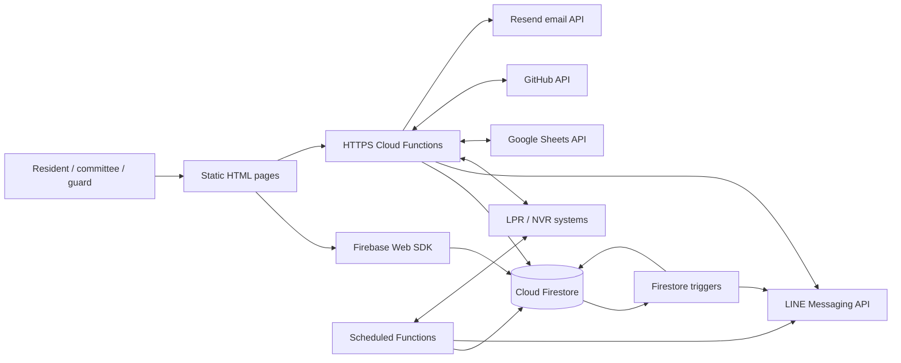

# Current architecture

## Executive summary

The system is a Firebase-based modular product implemented mostly as a monolith. Static
HTML pages use two access styles: direct Firestore SDK access and HTTPS Cloud
Functions. Most backend handlers, integrations, triggers, and test exports still
live in `functions/index.js` (12,627 lines at audit start; 12,331 after the first
behavior-preserving extractions).

This works operationally, but it makes impact analysis slow: locating a feature
requires searching one large file, dependencies are implicit, API conventions
vary by handler, and most deployed exports lack isolated contract tests.

## Runtime map

## Source boundaries

| Boundary | Current source | Responsibility |
|---|---|---|
| Issue board | `index.html` | Direct CRUD for `issues` and `private_issues` |
| LPR daily log | `lprlog/index.html` | Calls `dailyTrafficReport` |
| Guard plate check | `lprcheck/index.html` | Calls `lprGuardLookup` |
| Visitor board | `visitorboard/index.html` | Calls `dailyTrafficReport` and `getResidentData` |
| Backend composition root | `functions/index.js` | All deployed exports; most handlers/integrations/domain logic remain here |
| Shared HTTP compatibility | `functions/platform/http.js` | Existing CORS/cache header behavior |
| Firestore path registry | `functions/platform/firestore-paths.js` | Collection and config path names |
| Payment resident repository | `functions/domains/payments/resident-repository.js` | Direct resident lookup with legacy fallback |
| Payment receipt repository | `functions/domains/payments/receipt-repository.js` | Atomic existence/counter allocation |
| Admin access policy | `functions/domains/auth/admin-access-policy.js` | Permission keys/default grants/normalization |
| Resident car quota | `functions/domains/residents/car-quota.js` | Quota parsing and business rules |
| Visitor normalization | `functions/domains/visitors/normalization.js` | Names, plates/provinces, vehicle/document normalization |
| Visitor intake state | `functions/domains/visitors/intake-state.js` | Session split decisions and aggregate status |
| Browser access policy | `firestore.rules` | Public access for four collections |
| Query indexes | `firestore.indexes.json` | One visitor intake composite index |
| Tests | `functions/test/` | Visitor pure-helper tests and narrow deployed smoke/SIT checks |

## Data access patterns

### Direct browser to Firestore

`index.html` directly queries and mutates `issues` and `private_issues`. It also
updates votes and reply arrays client-side. This path bypasses the backend's API
conventions and is governed only by `firestore.rules`.

### Browser to HTTPS function

LPR and visitor pages send JSON to fixed regional function URLs. CORS, method
validation, authentication, error shapes, and caching are implemented separately
inside each handler.

### Event-driven paths

- Resident changes trigger LPR synchronization.
- New public/private issue documents trigger LINE notifications.
- LPR event changes trigger image/vision and Agent C processing.
- Scheduled jobs generate visitor, traffic, overnight, guard, and reconciliation
  reports and retry asynchronous work.

## Primary architecture friction

1. **Mostly monolithic source unit:** unrelated domains still share one module and
   initialization scope, though HTTP headers and Firestore paths are now extracted.
2. **Implicit dependencies:** handler-to-helper, collection, secret, and external
   service relationships are not declared in a registry.
3. **Mixed access model:** direct Firestore CRUD and backend-mediated CRUD coexist.
4. **Variable API contracts:** HTTP method, auth, CORS, and errors are repeated and
   not uniformly represented.
5. **Caller visibility gap:** most exports have no caller in this repository; safe
   changes require checking other subprojects and production logs.
6. **Test concentration:** strong visitor helper coverage does not establish
   contract coverage for the other deployed domains.

## Essential safety boundary

This audit does not prioritize penetration testing. It retains checks that protect
correct operation: resident/committee authorization boundaries, webhook identity,
idempotent event handling, and prevention of cross-house or partial writes.
