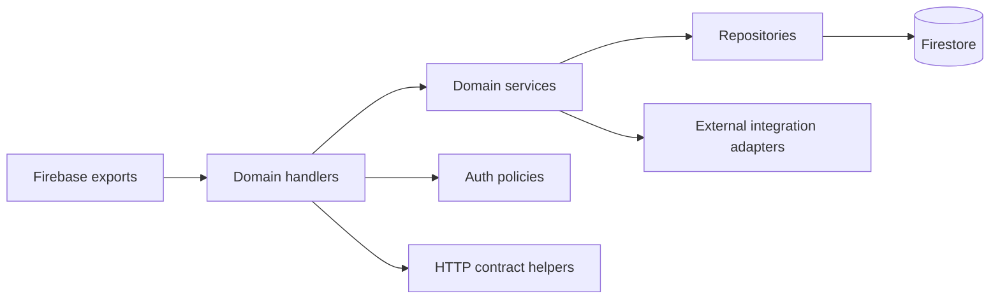

# Target architecture and migration plan

## Design objective

Make feature ownership and data flow obvious to AI and developers while keeping
Firebase export names and production behavior stable.

## Proposed source layout

```text
functions/
  index.js                 # composition root; exports only
  platform/
    firebase.js            # admin initialization and shared clients
    http.js                # CORS, method guard, response/error envelope
    errors.js
    observability.js
  auth/
    resident-auth.js
    admin-access.js
    webhook-auth.js
  domains/
    residents/
      handlers.js
      service.js
      repository.js
      contracts.js
    lpr/
    visitors/
    issues/
    polls/
    documents/
    bulky-waste/
    payments/
  integrations/
    line.js
    lpr-device.js
    nvr.js
    google-sheets.js
    github.js
    resend.js
  test/
    unit/
    contract/
    integration/
```

Dependency direction:



Repositories must not import handlers. Integrations must not know Express
request/response objects. Domain services receive validated values, not raw
`req.body`.

## API convention

For new or migrated HTTP handlers:

- One shared method/CORS wrapper.
- Explicit request validator per action.
- Success: `{ok: true, data: ...}`.
- Failure: `{ok: false, error: {code, message, details?}}`.
- Stable status mapping for method, validation, authentication, authorization,
  not-found, conflict, dependency, and internal errors.
- An explicit auth policy next to every handler export.
- A request/correlation ID in structured logs.

Existing clients must keep receiving their current shape until a compatibility
adapter and contract test prove migration safety.

## AI navigation artifacts

Maintain these alongside code:

- `docs/audit/function-inventory.md` for human overview.
- A future machine-readable `functions/manifest.js` or JSON registry describing
  export, domain, trigger, auth policy, collections, and known caller.
- A short `README.md` in every domain stating entry points, data ownership, and
  commands/tests.
- Contract tests named after the deployed export.
- `AGENTS.md` updated with the module map after migration begins.

## Incremental migration phases

Implementation status: Phase 0 is in progress. The deployed-export snapshot,
HTTP compatibility tests, centralized Firestore path registry, and AI navigation
guide are present. Runtime handlers and public payloads have not been changed.

### Phase 0 — Baseline and contracts

1. Capture lint/unit results and export list.
2. Add non-production contract tests for current status/body behavior.
3. Record known callers across all sibling Pattra projects.
4. Measure latency and Firestore read counts for optimization candidates.

Gate: no handler movement until its current public contract is tested.

### Phase 1 — Extract shared platform code

Move response, CORS, errors, logging, validation, and auth policies behind
compatibility helpers. Do not change export names or client payloads.

Current progress: CORS/cache headers, compatible method/error helpers, and
Firestore path constants are extracted. Lifestyle Survey uses the shared HTTP
compatibility helpers. Admin permission policy, resident car-quota rules, and two
payment repositories are extracted. Handler-level auth verification, validation,
logging, and most domain logic remain in `index.js`. Visitor normalization and
intake-state rules are isolated under `domains/visitors/`.

Gate: lint, unit tests, contract tests, and export-set comparison pass.

### Phase 2 — Extract one low-coupling domain

Use Visitor Intake first because it already has pure-helper tests and a narrow
SIT/smoke path. Keep `index.js` as the export composition root.

Gate: existing visitor unit tests plus local/emulator contract tests pass.

### Phase 3 — Extract resident/access and LPR

Separate resident repositories/auth from LPR synchronization, then split traffic,
reporting, NVR, and Agent C workflows. Add idempotency and query measurements
without changing event semantics.

Gate: cross-house authorization, resident-to-LPR sync, duplicate event, and
Bangkok date-boundary tests pass.

### Phase 4 — Remaining domains and client alignment

Extract issues, polls, documents, bulky waste, and payments. Replace duplicated
client endpoint strings with a documented client API map. Consider moving direct
Firestore writes behind handlers only when a behavior-compatible migration is
planned.

### Phase 5 — Performance changes

Optimize only measured bottlenecks: bounded queries, indexes, cached/derived
reports, batched lookups, and schedule short-circuiting. Capture before/after
latency and Firestore operation counts.

## Rollback strategy

- Each phase is a focused commit with unchanged deployed export names.
- New modules are invoked through the existing `index.js` exports.
- Keep compatibility adapters until all known clients are verified.
- Roll back a module extraction independently; do not combine it with schema
  migration or production data rewrite.
- Any Firestore schema change requires a separate migration and recovery plan.
